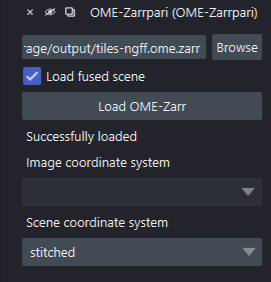

# ome-zarrpari

Load and use OME-Zarr 0.4, 0.5 and 0.6 images, labels and scenes in napari, from any data source!

Images are loaded into a *napari multiscale image layer*.
This means higher resolution levels of the data are progressively loaded as you zoom in.

This plugin also: loads label groups; sets axis labels, units, and scales.

## Usage
This is what the widget looks like:



You can either copy/paste a URL or local path into the text box, or press "Browse" to open a file browser and select a local directory.
Then press the "Load OME-Zarr" button to load the image.
This first removes the layers previously loaded by the plugin; other layers are kept.

### Scenes
OME-Zarr 0.6 scenes combine several images (e.g. tiles) with coordinate transformations
that place them in shared scene coordinate systems.
Each scene image is loaded as separate layers, named after its path in the scene,
and placed in the first coordinate system of the scene.
If the scene has more than one coordinate system, you can switch between them with the
"Scene coordinate system" dropdown, which applies to the most recently loaded scene.

Only transformations that can be converted to an affine transformation are supported.
Images that can't be placed in the selected scene coordinate system are shown in their
own (intrinsic) coordinate system, with a warning.

Scenes with many images (e.g. hundreds of tiles) are slow to show as separate layers.
Tick "Load fused scene" before loading to fuse the scene images into a single
layer per channel and per label image.
By default each scene image is shown as separate layers.
Fused layers are lazy: only the parts you look at are read and fused.
Images that are only shifted are copied (rounded to whole pixels); rotated or scaled
images are resampled.
Where images overlap, the fused image shows the maximum value, and fused labels show
the last non-zero label.
Images with different data types are fused into separate layers.
The checkbox applies when loading; the coordinate system dropdown re-shows the most
recently loaded scene.

### Programmatic usage
If you already have a Zarr group you want to add to a napari Viewer, you can use:

::: ome_zarrpari.load_ome_zarr
    options:
      heading_level: 4


## Installing

```
pip install ome-zarrpari
```

If napari is not already installed, you can install `ome-zarrpari` with napari and Qt via:

```
pip install "ome-zarrpari[all]"
```

!!! warning

    After installing, be sure to enable napari's asyncronous mode.
    Without this browsing data will be very slow.
    You can either go to "Preferences" > "Experimental" to enable it, or set the `ASYNC_NAPARI` environment variable to 1 before launching napari.


## FAQ

### What's the difference between `ome-zarrpari` and [`napari-ome-zarr`](https://napari-hub.org/plugins/napari-ome-zarr)?

- `napari-ome-zarr` has no widget.
  The only way to load remote datasets is launching `napari` on the command line, or using Python scripting in the `napari` terminal.
- `ome-zarrpari` supports OME-Zarr 0.4, 0.5 and 0.6 (beta); `napari-ome-zarr` only supports version 0.4 (as of writing).
- `ome-zarrpari` explicitly supports all versions of Python supported by both `napari` and `ome-zarr-models`.

### How can I process OME-Zarr data once it's been loaded?

Images are loaded into napari multiscale images.
The list of images in `napari` can be found in the `viewer.layers` list.
Each multiscale image in the list has a `image.data` attribute, which stores a list of the multiscale image levels.
Each item in this list is a `dask.Array`, which wraps a `zarr.Array` under the hood.
The image at index `i` is downsampled by a factor of `2**i`.


## Changelog

**Unreleased**

- Add support for loading OME-Zarr 0.6 images and labels.
  Images are loaded in their intrinsic physical coordinate system.
  Note that OME-Zarr 0.6 support in `ome-zarr-models` is still in beta.
- Add support for loading OME-Zarr 0.6 scenes.
  Scene images are placed in a scene coordinate system, which can be selected in the widget.
- Pressing "Load OME-Zarr" first removes the layers previously loaded by the plugin.
- Switching the scene coordinate system keeps the current view, also for fused scenes.
- Require napari >= 0.9.
- Add an option to fuse the images of a scene into one layer per channel and label image,
  for fast viewing of scenes with many images
  (`fuse_scenes` in `load_ome_zarr`, and the "Load fused scene" checkbox in the widget, off by default).
- Apply the translation of the highest resolution dataset to the loaded layers
  (previously only the scale was applied).
- Axes without a unit get the napari default unit ('pixel'), as in napari-ome-zarr
  (previously no units were set if any axis had no unit, with a warning).
- Require `ome-zarr-models >= 1.9`.
- Drop support for Python 3.11, as `ome-zarr-models` no longer supports it.

**1.0.2**

- Fix loading OME-Zarr 0.5 labels that are associated with an image.
- Data is now always loaded into a `dask` array, as promised above.
  This allows it to take advantage of naparis built in data caching.

**1.0.1**

- Fix loading OME-Zarr 0.5 data that uses a v2 chunk encoding for the arrays.
- Add an explicit `napari` dependency.

**1.0.0**

First release
